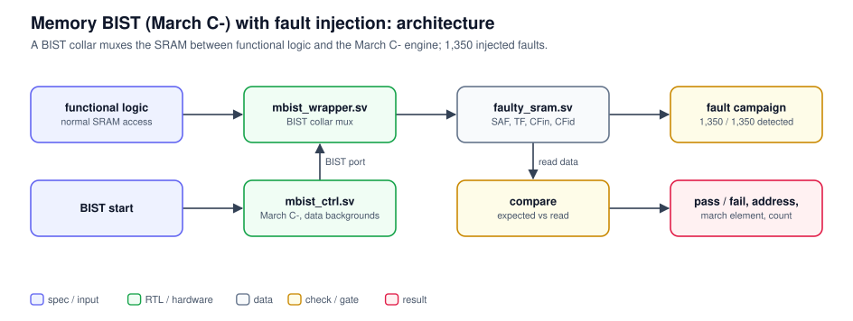
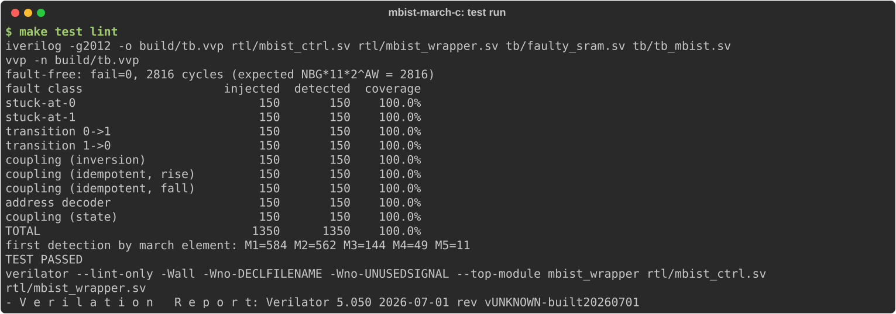

# Memory BIST controller (March C−) with a fault-injection campaign

[](https://github.com/Ana2601/mbist-march-c/actions/workflows/ci.yml)

Programmable memory built-in self-test controller with a BIST collar, evaluated by injecting realistic SRAM fault models and measuring fault coverage.



## Design

- `rtl/mbist_ctrl.sv`: March C− `{⇕(w0); ⇑(r0,w1); ⇑(r1,w0); ⇓(r0,w1); ⇓(r1,w0); ⇕(r0)}`, repeated over log₂(DW)+1 **data backgrounds** (solid, 0101…, 0011…, …), so coupling faults between bits of the same word are also sensitised
- Reports pass/fail, first failing address, expected and actual data, the march element that caught it, and a saturating miscompare count, which is what a repair or diagnosis flow consumes
- `rtl/mbist_wrapper.sv`: BIST collar that muxes the SRAM pins between functional logic and BIST
- Test length: NBG · 11 · 2^AW cycles (2,816 for 64×8)

## Fault-injection campaign (`tb/`)

`tb/faulty_sram.sv` is a behavioural SRAM that can carry one fault from each industry-standard class:

| Fault class | Injected | Detected | Coverage |
|---|---|---|---|
| Stuck-at-0 | 150 | 150 | 100 % |
| Stuck-at-1 | 150 | 150 | 100 % |
| Transition 0→1 | 150 | 150 | 100 % |
| Transition 1→0 | 150 | 150 | 100 % |
| Coupling, inversion | 150 | 150 | 100 % |
| Coupling, idempotent (rise) | 150 | 150 | 100 % |
| Coupling, idempotent (fall) | 150 | 150 | 100 % |
| Address decoder | 150 | 150 | 100 % |
| Coupling, state | 150 | 150 | 100 % |
| **Total** | **1,350** | **1,350** | **100 %** |

Half of the coupling faults are placed between two bits of the **same word**; the data backgrounds are what catch those. First detection by march element: M1 584, M2 562, M3 144, M4 49, M5 11. Also checked: the fault-free memory passes in exactly the predicted cycle count, and the functional port is transparent when BIST is idle.

## Run

```bash
make test
make lint
make synth
```

## Test run

Output of the CI command (`make test lint`), captured from a local run:



## Limitations / next steps

Single-port SRAM, one memory per controller, March C− only (no programmable algorithm). Natural extensions are a programmable march sequencer and a built-in redundancy analysis for row/column repair.

## Setup

- [OSS CAD Suite](https://github.com/YosysHQ/oss-cad-suite-build) (Icarus Verilog, Verilator, Yosys)

```bash
make test
make lint
```

The same commands run in CI on every push (`.github/workflows/ci.yml`).
